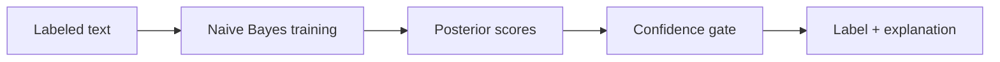

# Trustworthy-NLP

**Selective binary text classification with token explanations**

 

## Overview

Selective binary text classification with token explanations. This compact, dependency-free Python baseline is intended for reproducible experimentation and extension.

## Architecture



## Quick start

```bash
git clone https://github.com/rohanst14/Trustworthy-NLP.git
cd Trustworthy-NLP
python -m pip install -e .
python examples/demo.py
python -m unittest discover -s tests -v
```

## Example

```python
from trustworthy_nlp import *
result = NaiveBayes().fit([('normal safe',0),('danger alarm',1)]).predict('danger alarm',.6)
print(result)
```

## Repository guide

| Path | Purpose |
|---|---|
| [src/trustworthy_nlp](src/trustworthy_nlp) | Core implementation |
| [examples/demo.py](examples/demo.py) | Runnable synthetic demonstration |
| [tests/test_core.py](tests/test_core.py) | Regression tests |
| [docs/methodology.md](docs/methodology.md) | Method and limitations |

## Limitations

Toy classifier, not calibrated by default. Brier score measures probabilistic error; no real-world benchmark or OOD guarantee.

This is an AI-assisted portfolio prototype, not a production system or published scientific result.
